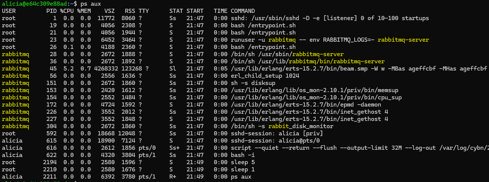
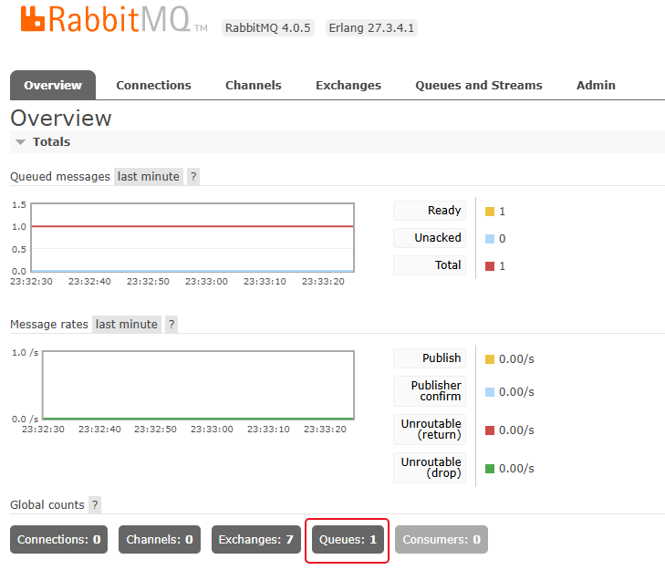
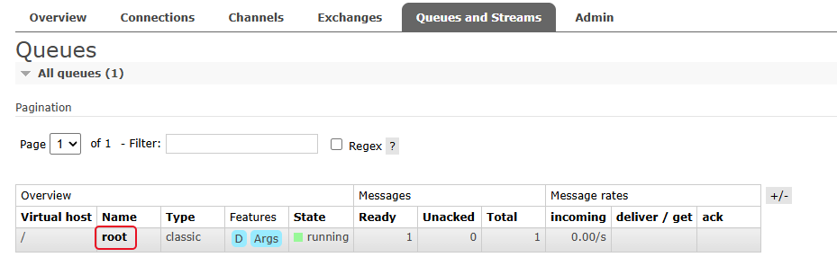
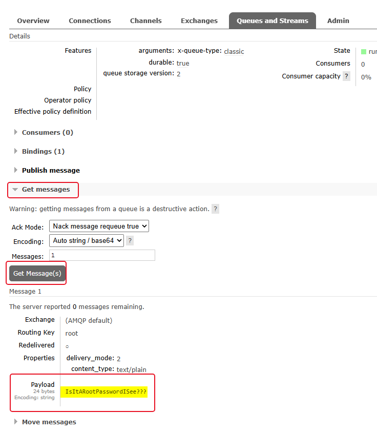

En se connectant au serveur, rien de notable n'apparait. Aucune vraie note exploitable, pas de présence de ``sudo``.

En revanche, en regardant les process à l'aide de la commande ``ps``, par exemple avec les arguments `ps aux`, on voit le peu de processus en train de fonctionner sur le serveur :


Beaucoup de termes indiquent un service appelé ``rabbitmq``, cohérent avec la référence du Lapin de Alice au Pays des Merveilles du titre.

Internet nous apprendra que ``rabbitmq`` est un service permettant de gérer des données en fil d'attente (queue). En gros y'a de la donnée contenue dedans.

On tente des commandes ``rabbit``, mais rien n'existe.

Sur internet, on peut chercher qu'il existe une API avec laquelle intéragir sur ce service, but you may observe that :
```bash
alicia@e64c309e88ad:~$ curl
bash: curl: command not found
alicia@e64c309e88ad:~$ wget
bash: wget: command not found
alicia@e64c309e88ad:~$ python3
bash: /usr/bin/python3: Permission denied
```

Ce qui est pas mal chiant.

On vérifie les configurations du serveur :
```bash
alicia@e64c309e88ad:~$ cat /etc/rabbitmq/rabbitmq.conf
listeners.tcp.default = 127.0.0.1:5672
management.tcp.ip = 127.0.0.1
management.tcp.port = 15672
loopback_users.guest = true
```

Le service est alors exposé sur le port 5672, mais uniquement en localhost. Une seconde API de management existe aussi sur le port 15672.

Analysons : 
- localhost uniquement, impossible d'y accéder en dehors de la VM
- pas de client local dans la VM, donc impossible d'accéder facilement à l'API
- j'ai la flemme de faire ça en ``bash``

On va donc chercher à résoudre le premier problème : faire sauter la limitation à localhost, grâce au concept de **port forwarding**

Le protocole SSH permet de rediriger les ports ouverts localement sur le système cible, pour le rediriger vers le système source.

Pour ce faire, utilisons le paramètre ``-L`` en se connectant, de telle sorte que : `-L <port_local>:<hote_distant>:<port_distant>`
Donc par exemple :
```bash
ssh alicia@challenges.cybn.fr -p 10111 -L 15672:localhost:15672
```

Une fois connecté, on peut ouvrir ``localhost:15672`` dans un navigateur par exemple :


Désormais, besoin de se connecter.
Mais fort heuresement, dans la configuration on a vu : 
```bash
loopback_users.guest = true
```

Petite recherche internet, et on trouve que cela active le compte ``guest:guest``. Suffit de s'y connecter du coup.

Ensuite, on cherche la donnée, dans les "queues" :




On voit un petit password intéressant : ``IsItARootPasswordISee???``

Comme indiqué dans le contenu, c'est probablement le moit de passe du compte ``root``. On test, et comme par magie, ça marche :)
```bash
alicia@e64c309e88ad:~$ su root
Password:
root@e64c309e88ad:/home/alicia# cd
root@e64c309e88ad:~# ls
flag.txt
root@e64c309e88ad:~# cat flag.txt
CYBN{Th3_Wh1te_R4Bb17_i5_CréT1n}
```

> CYBN{Th3_Wh1te_R4Bb17_i5_CréT1n}